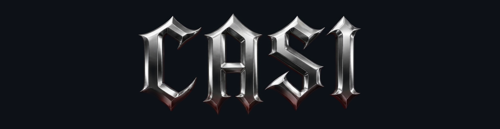
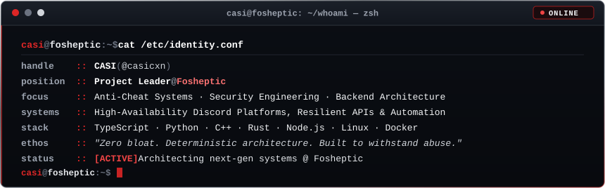
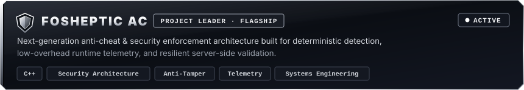

 

  

&nbsp;&nbsp;

  

 

 

  

 

 

  

 

<code>// LANGUAGES</code>

  
  
  
  
  
  
  
  
  
  

<code>// RUNTIME · FRAMEWORKS · BOT SYSTEMS</code>

  
  
  
  
  
  
  
  

<code>// DATABASES · CACHING</code>

  
  
  
  
  

<code>// INFRASTRUCTURE · TOOLING</code>

  
  
  
  
  
  
  

 

 

 

  

  
  &nbsp;
  

 

 

 

  
  &nbsp;
  

  

  

 

 

 

<picture>
  <source media="(prefers-color-scheme: dark)" srcset="https://raw.githubusercontent.com/casicxn/casicxn/output/github-contribution-grid-snake-dark.svg" />
  <source media="(prefers-color-scheme: light)" srcset="https://raw.githubusercontent.com/casicxn/casicxn/output/github-contribution-grid-snake.svg" />
  
</picture>

  

